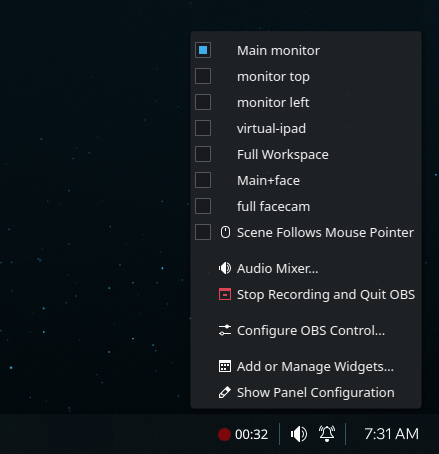
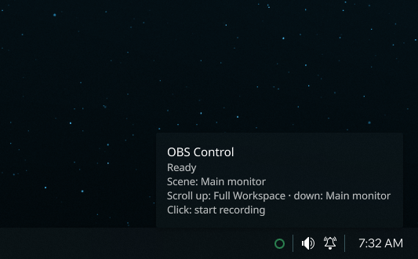
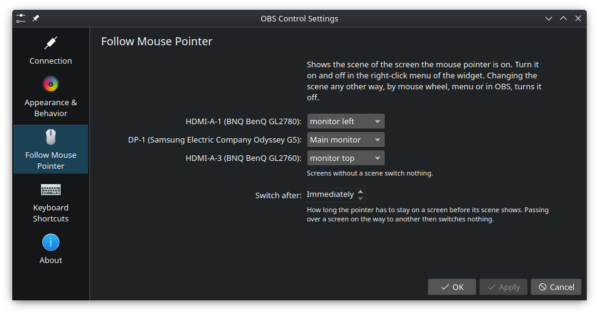
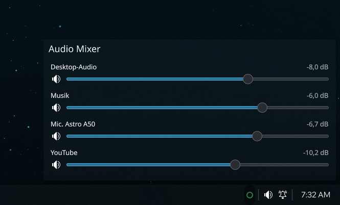

# OBS Control – Plasma 6 Widget

Shows in the panel whether OBS Studio is recording, and starts, stops or
pauses the recording with a click. The context menu lets you switch scenes
and open an audio mixer. Speaks obs-websocket v5 (built into OBS since
version 28).





| Indicator | Meaning | Click |
| --- | --- | --- |
| Red, pulsing dot + duration | Recording | Stop recording |
| Orange dot + duration | Recording paused | Stop recording |
| Empty circle | Connected, not recording | Start recording |
| Faded circle | OBS is not running | Reconnect immediately |
| Red circle outline | Password missing or wrong | Open settings |

| Input | Effect |
| --- | --- |
| Click | Start or stop recording (configurable: double-click for both, or only for stopping) |
| Middle click | Pause or resume the running recording |
| Mouse wheel up/down | Switch to the scene chosen for it in the settings |
| Press and hold | Stop and discard the running recording (a red ring shows the progress, releasing early cancels; only when OBS runs on this computer) |
| Press and hold while OBS is not running | Start OBS (green ring); if OBS is already running but without a WebSocket connection, the widget says so instead of starting a second OBS. Optionally OBS starts minimized to the taskbar or the system tray and begins recording right away (Settings → Appearance & Behavior) |
| Right click | Menu with all scenes (current one checked), “Scene Follows Mouse Pointer”, “Audio Mixer…” and “Quit OBS” (only when OBS runs on this computer); a running recording is stopped and saved first |

**Scene follows the mouse pointer:** With several screens, OBS shows the
scene of the screen the mouse pointer is currently on. Which scene belongs to
which screen is set under “Follow Mouse Pointer” in the settings, as is how
long the pointer has to stay on a screen before the scene switches
(immediately up to 5 s, default 0.5 s). That way a pointer just passing over
a screen does not trigger a switch. The feature is toggled in the context
menu. Switching the scene any other way (mouse wheel, menu, in OBS) turns it
off. The tooltip shows whether it is active.



The audio mixer shows every OBS source with audio, each with a volume slider
and a mute button. The slider follows the same curve as the mixer in OBS, so
the same position means the same volume. Changes in OBS show up in the widget
immediately and vice versa.



When discarding, the file goes to the trash or is deleted permanently,
depending on the setting; the hold duration (0.5–5 s, default 1.5 s) can be
set separately for discarding and for starting OBS.
OBS itself cannot delete files, so the widget does it via `kioclient` or
`rm`. On drives without a trash the file stays where it is, and a
notification says so.

After stopping, a notification shows the file name, with an “Open Folder”
button. It can be turned off under “Appearance & Behavior”.

Color and opacity for “OBS closed”, “OBS running” and “Recording”, as well as
the duration display, can be changed under “Appearance & Behavior” in the
widget settings. Without a custom color, the Plasma theme color applies. At
0 % opacity the dot stays invisible but remains clickable.

While OBS is not running, the widget tries to connect every 3 seconds, every
15 seconds after a rejected password. The tooltip names the exact state.

## Requirements

- Plasma 6, Qt module `QtWebSockets` for QML (Arch: `qt6-websockets`)
- In OBS: Tools → WebSocket Server Settings → “Enable WebSocket server”

## Installation

From the [KDE Store](https://store.kde.org/p/2380430): right-click the
panel → “Add Widgets…” → “Get New Widgets…” → “Download New Plasma
Widgets…” → search for “OBS Control”.

From the source code:

```sh
kpackagetool6 -t Plasma/Applet -i package
```

Then right-click the panel → “Add Widgets…” → drag “OBS Control” onto the
panel. Right-click the widget → “Configure OBS Control…” → enter the
password.

Updating after code changes:

```sh
kpackagetool6 -t Plasma/Applet -u package
```

Plasma reloads the QML files of widgets that are already running only after
a restart of the shell: `systemctl --user restart plasma-plasmashell`.

Removing: `kpackagetool6 -t Plasma/Applet -r io.github.neongrau23.obscontrol`

As a file for the KDE Store or for passing on:
`scripts/build-plasmoid` creates `dist/<id>-<version>.plasmoid`, installable
with `kpackagetool6 -t Plasma/Applet -i <file>` or via “Get New Widgets…” →
“Install Widget From Local File…”.

## Trying it without installing

```sh
plasmoidviewer -a package                              # as a desktop widget
plasmoidviewer -a package -l topedge -f horizontal     # as in a panel
```

## Tests

```sh
tests/run-tests.sh
```

Checks the SHA-256/Base64 implementation against Node (`node`), the slider
curve against reference values from libobs, the hold time and scene mapping
of “Scene follows the mouse pointer”, and the connection client against a
mock OBS server (`python3` with `websockets`): wrong password, connecting,
starting/stopping a recording including duration and file path, discarding,
pausing and resuming, scene list, switching and renaming scenes, audio
sources with volume and muting, restarting OBS with automatic reconnect,
missing password. The real OBS instance is not touched (the mock runs on port
14455).

`tests/mock-obs.py` can also be started on its own to try the widget without
OBS: set the port in the widget to 14455 and the password to `testpass`.

## Translations

The texts in the code are English; translations live in `po/`: German in
`po/de.po`, Dutch in `po/nl.po` (thanks to Heimen Stoffels).
After changing texts:

```sh
scripts/update-translations
```

The script writes new texts to `po/template.pot` and into every
`po/<language>.po`, where they get translated, and compiles the translations
into `package/contents/locale/` (tools: `xgettext`, `msgmerge`, `msgfmt` from
gettext). A new language starts as a copy of `po/template.pot` named
`po/<language>.po`. Plasma loads the translations only for the installed
widget, not with `plasmoidviewer -a package`.

## A note on the password

Plasma stores the password in plain text in the widget configuration
(`~/.config/plasma-org.kde.plasma.desktop-appletsrc`). For an obs-websocket
server that is only reachable locally this is acceptable; a password used
anywhere else does not belong there.

## Structure

| File | Contents |
| --- | --- |
| `package/contents/ui/ObsClient.qml` | WebSocket connection, authentication, recording state, reconnecting |
| `package/contents/ui/Mixer.qml` | Audio mixer popup |
| `package/contents/ui/fader.js` | Slider curve of the OBS mixer (position ↔ volume) |
| `package/contents/ui/follow.js` | Scene follows the mouse pointer: screen → scene mapping, hold time |
| `package/contents/ui/seconds.js` | Reads seconds typed with comma or point in the settings |
| `package/contents/ui/ScreenFollower.qml` | Scene follows the mouse pointer: switching and detecting other scene changes |
| `package/contents/ui/SceneComboBox.qml` | Scene picker for the settings pages |
| `package/contents/ui/sha256.js` | SHA-256 and Base64 for authentication (QML has no access to `QCryptographicHash`) |
| `package/contents/ui/main.qml` | Panel indicator, tooltip, click behavior, scene menu, notification |
| `package/contents/ui/configGeneral.qml` | Settings page “Connection” (host, port, password) |
| `package/contents/ui/configAppearance.qml` | Settings page “Appearance & Behavior” (click mode, mouse wheel scenes, discarding, colors, opacity, duration, notification) |
| `package/contents/ui/configFollowMouse.qml` | Settings page “Follow Mouse Pointer” (scene per screen, hold time) |
| `package/contents/config/main.xml` | Configuration keys and defaults |
| `package/metadata.json` | Plugin ID, name, description, version, license |
| `po/` | Translation template and translations |
| `scripts/update-translations` | Extract texts, merge and compile translations |
| `scripts/build-plasmoid` | Build the `.plasmoid` file for the KDE Store |

How the parts work together, decisions with their reasons, and workflows for
developers: [docs/](docs/README.md).

## License

Copyright (C) 2026 Neongrau23

Free software under the GNU General Public License, version 2 or (at your
option) any later version (GPL-2.0-or-later). The license text is in
[LICENSE](LICENSE).
